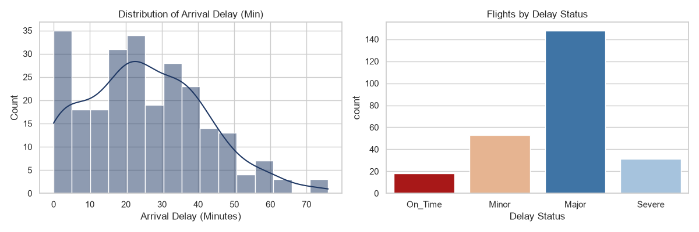
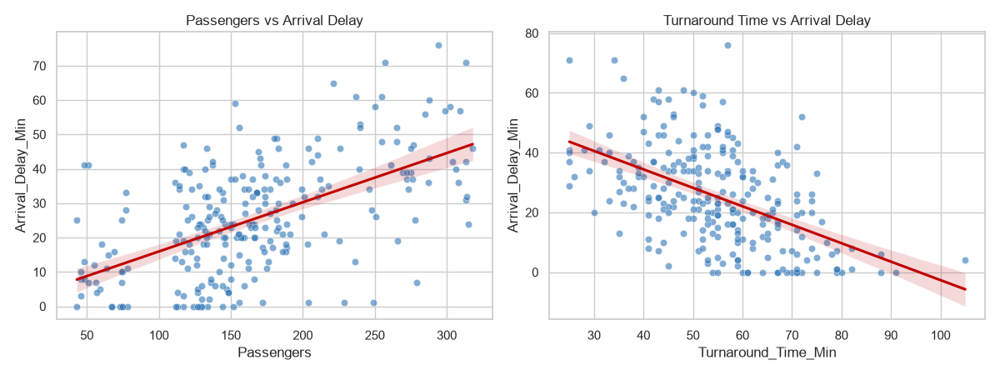
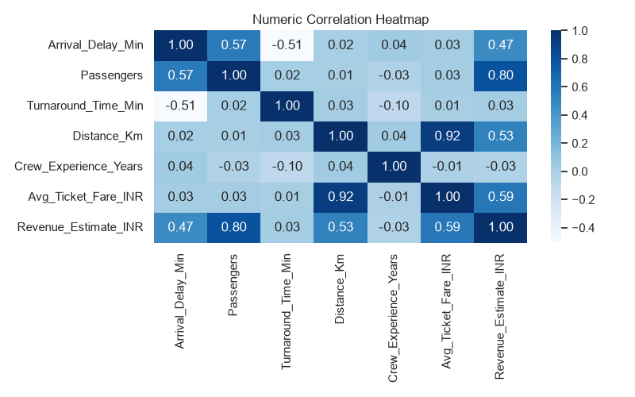
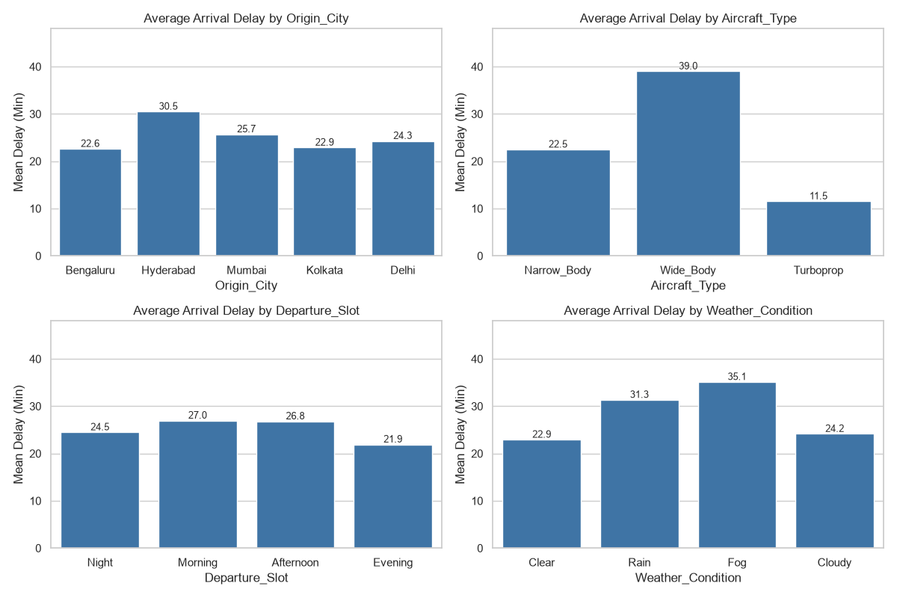

# Why Are Flights Late? A Delay Analysis of Domestic Indian Flights

A beginner-friendly data analysis project exploring what drives arrival delays on domestic Indian flights using Python, pandas, NumPy, matplotlib, and seaborn.

> The dataset (`flights_data.csv`, seed `10608`) is **synthetic** (computer-generated) for educational analysis.

## Business problem
The operations team of a domestic airline wants to cut late arrivals, because delays cost money in passenger compensation, crew overtime, and missed connections. This analysis identifies which conditions go with longer delays so the team can decide where to put its limited effort first.

## Questions answered
1. What does `Arrival_Delay_Min` look like overall? (average, median, spread, shortest/longest delays, distribution shape)
2. Do `Passengers` and `Turnaround_Time_Min` affect `Arrival_Delay_Min`? Does any other numeric column matter?
3. Does `Arrival_Delay_Min` differ by `Origin_City`, `Aircraft_Type`, `Departure_Slot`, and `Weather_Condition`?
4. Which flights need attention? (`At_Risk` = `Arrival_Delay_Min >= 45` minutes)

## Dataset
`data/raw/flights_data.csv` – 255 rows, 12 columns (`Flight_ID`, `Flight_Date`, `Origin_City`, `Aircraft_Type`, `Departure_Slot`, `Weather_Condition`, `Distance_Km`, `Passengers`, `Turnaround_Time_Min`, `Crew_Experience_Years`, `Avg_Ticket_Fare_INR`, `Arrival_Delay_Min`).
The raw file includes duplicate rows, inconsistent casing/spaces in `Origin_City`, out-of-range passenger counts, and missing values for data-cleaning practice.

## Project structure
```
flight-delay-analysis/
├── data/
│   ├── raw/flights_data.csv
│   └── processed/flights_data_clean.csv
├── notebooks/flight_delay_analysis.ipynb
├── images/                  (charts saved by the notebook)
├── requirements.txt
├── .gitignore
└── README.md
```

## How to run
```bash
cd flight-delay-analysis
pip install -r requirements.txt
jupyter notebook notebooks/flight_delay_analysis.ipynb
```

## Steps followed
1. Load and inspect raw flight records
2. Clean data (remove 5 duplicate rows, standardize `Origin_City`, fix invalid `Passengers`, impute missing values)
3. Engineer new columns (`Revenue_Estimate_INR`, `Delay_Status`, `At_Risk`, `Distance_Band`)
4. Exploratory analysis with summary stats and charts
5. Operational insights and recommendations

## Key findings (from this dataset)
- **Overall delay:** Mean delay is **25.3 min** (median **24.0 min**, std dev **16.4 min**, min **0 min**, max **76 min**); **12.4%** (31/250) of flights are **At Risk** (`>= 45 min`).
- **Numeric drivers:** `Passengers` (`r = +0.57`) and `Turnaround_Time_Min` (`r = -0.51`) show the strongest relationships with `Arrival_Delay_Min`.
- **Group differences:** `Wide_Body` aircraft average **39.0 min** delay (`35.9%` At Risk), and `Fog` (**35.1 min**) / `Rain` (**31.3 min**) weather conditions cause steep delay spikes.
- **Origin & slots:** `Hyderabad` has the highest average delay (**30.5 min**, `22.0%` At Risk), while `Evening` departures show the highest At Risk share (`16.9%`).

## Charts





## Tools
Python 3 · pandas · NumPy · matplotlib · seaborn · Jupyter Notebook · Git and GitHub
